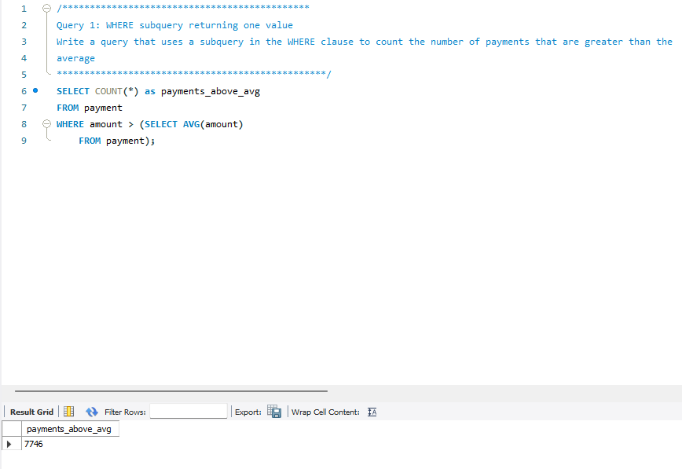

# Chapter7
<b>Table of Content</b>
- [Summary](#summary)
- [Workers](#workers)
- [New Concepts Used](#new-concepts-used)
- [Browser Output Example](#browser-output-example)

## Summary
Subqueries

## Workers
[@jacobczapla](https://github.com/jacobczapla) Jacob Czapla

## New Concepts Used
- WHERE subquery returning one value
- WHERE clause using IN operator subquery returning a list
- WHERE clause using the ALL operator subquery returning a list
- WHERE correlated subquery running multiple times (once for each outer
row)
- WHERE subquery using EXISTS operator returning a Boolean value
- SELECT subquery returning a single value
- FROM subquery returning a inline view (temporary table)
- 
## Browser Output Example
##Query 1

